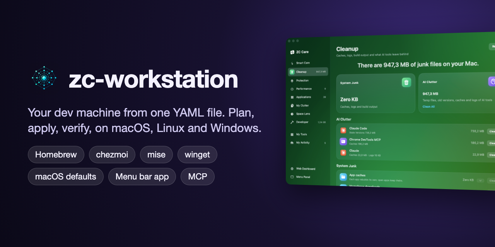
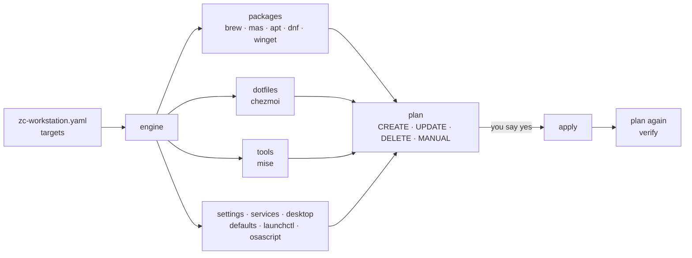

<p align="center">
  
</p>

# zc-workstation

[](https://github.com/ZoolCoder/zc-workstation/actions/workflows/ci.yml)
[](https://zoolcoder.github.io/zc-workstation/)
[](LICENSE)
[](go.mod)


**Set up your developer machine from one YAML file, and keep it that way.**

zc-workstation manages the whole setup of a developer machine:

- Homebrew formulae and casks, and Mac App Store apps
- apt, dnf and winget packages
- dotfiles, through chezmoi
- language runtimes, through mise
- macOS settings and background services
- the wallpaper and screen saver

It reads what the machine has and shows you the difference as a plan. Only
if you say so does it close the gap. Then it reads the machine again to
prove the change took.

Think `terraform plan` and `terraform apply`, for your laptop.

```console
$ zc-workstation plan
CREATE  brew      cask:ghostty              install with brew
CREATE  brew      brew:lazygit              install with brew
UPDATE  dotfiles  .gitconfig                update; changed outside chezmoi, apply overwrites it
CREATE  runtimes  java@temurin-25           install with mise
CREATE  macos     com.apple.dock autohide   set to true

$ zc-workstation apply
done  CREATE brew cask:ghostty
done  CREATE brew brew:lazygit
...
applied and verified
```

## Contents

- [Why](#why)
- [How it works](#how-it-works)
- [Quick start](#quick-start)
- [The config](#the-config)
- [Commands](#commands)
- [Everyday workflows](#everyday-workflows)
- [Dashboard](#dashboard)
- [ZCBar and ZC Care, the menu bar app](#zcbar-and-zc-care-the-menu-bar-app)
- [The toolbox](#the-toolbox)
- [AI agents](#ai-agents)
- [Safety](#safety)
- [How it compares](#how-it-compares)
- [Project layout](#project-layout)
- [Status and roadmap](#status-and-roadmap)
- [Contributing](#contributing)

## Why

A developer machine is usually set up by:

- a `Brewfile`
- a dotfiles repo
- a `.tool-versions` or `mise.toml`
- a long `install.sh` full of `defaults write` lines

Each of these works alone, but nothing tells you how far the machine has
drifted from them. You find out when a new laptop is missing half your
tools, or when `install.sh` runs over a file you edited by hand.

zc-workstation puts one plan over all of them:

- **One view of the gap.** One command shows every package, dotfile, runtime
  and setting that is missing or different. It changes nothing while it
  looks.
- **Changes you review.** You see each action before it runs. A saved plan
  applies exactly what you reviewed, and nothing if the machine moved on.
- **Proof, not hope.** After every apply, it plans again. If a change ran
  but did not take, it says so and does not call it done.
- **The tools you already use.** It drives `brew`, `chezmoi`, `mise`,
  `defaults` and `launchctl`, and does not reimplement them. Your Brewfile
  and dotfiles stay plain files that work without it.
- **Every machine from one file.** A target can be limited to `darwin`,
  `linux` or `windows`. One config then serves your Mac, your Linux box and
  your Windows desktop.

## How it works



1. **Config.** The config is a list of *targets*. Each target names:
   - a *provider*, such as `packages`, `dotfiles` or `tools`
   - the file it manages, such as a Brewfile, a chezmoi source or a
     `mise.toml`
   - optionally, the systems it is for

   Relative paths resolve against the config file, so the same file works on
   every machine you clone it to.
2. **Read.** For each target on this system, the engine asks its provider
   what the machine has. Targets are read in parallel. A provider only
   reads; any write it would make is held inside an action.
3. **Plan.** Each difference becomes an action. Four kinds:

   | Action | Meaning |
   |---|---|
   | `CREATE` | Something declared is missing: install it, write it, start it. |
   | `UPDATE` | Something is there but differs: a changed dotfile, a wrong setting, an upgrade you asked for. |
   | `DELETE` | Something must go. Always needs a person's yes. |
   | `MANUAL` | Something no tool should do for you, like installing Homebrew itself or trusting a mise config. The plan says what to run, for example `mise does not trust mise.toml; review it, then run mise trust mise.toml`. |

4. **Apply.** The actions run in order. If one fails, it is reported and the
   rest still run, so one broken package does not block the others.
5. **Verify.** The engine plans again from scratch. If anything is left, the
   apply did not converge, and the tool says so and exits non-zero.

**Saved plans** pin what you reviewed:

```console
$ zc-workstation plan -out plan.json     # review this
$ zc-workstation apply plan.json         # applies exactly it
the live state changed since this plan was saved: ... re-run plan
```

On apply, it plans again and compares. It refuses if anything moved since you
reviewed the plan.

**Exit codes** make it scriptable:

| Code | Meaning |
|---|---|
| `0` | Nothing to do, or the apply converged and was verified. |
| `1` | Something failed. |
| `2` | With `-exit-code`: changes are outstanding. |
| `3` | With `-exit-code`: only `MANUAL` items are left. |

`plan`, `status` and `list` also take `-json`.

## Quick start

**1. Install.**

```console
$ go install github.com/zoolcoder/zc-workstation/cmd/zc-workstation@latest
```

You can also run `make install` in a clone, which puts it in `~/.local/bin`
(Go 1.26+). Releases add a Homebrew cask, Linux `.deb`, `.rpm` and `.apk`
packages, and Windows zips:

```console
$ brew tap zoolcoder/zc-workstation https://github.com/zoolcoder/zc-workstation
$ brew install --cask zc-workstation
```

**2. Write a config.** Start from the example, and point its paths at your
own Brewfile, dotfiles and `mise.toml`:

```console
$ mkdir -p ~/.config/zc-workstation
$ cp zc-workstation.example.yaml ~/.config/zc-workstation/zc-workstation.yaml
$ zc-workstation validate     # offline check of the config
```

Already have a set-up machine? `capture` writes its manifest for you:

```console
$ zc-workstation capture -target brew -out Brewfile
```

**3. Check the machine.**

```console
$ zc-workstation doctor
ok    system                       macbook darwin/arm64
ok    config                       ~/.config/zc-workstation/zc-workstation.yaml, 7 target(s)
ok    program brew                 /opt/homebrew/bin/brew
ok    program chezmoi              /opt/homebrew/bin/chezmoi
ok    program mise                 /opt/homebrew/bin/mise
warn  target brew                  78 of 80 packages installed (brew)
ok    security FileVault disk encryption
warn  security servers on every network interface   node:3000; bind dev servers to 127.0.0.1
```

**4. Plan, then apply.**

```console
$ zc-workstation plan
$ zc-workstation apply
```

**5. See where things stand.**

```console
$ zc-workstation status
packages  121 of 121 packages installed (brew)
home      36 of 36 dotfiles in place
runtimes  9 of 9 tools installed
look      wallpaper in place, screensaver in place, accent in place
macos     26 of 26 settings in place
services  6 of 6 services running
```

### A new Mac in one command

Keep your config in its own repo, which can be private. Then, on a fresh Mac:

```console
$ curl -fsSL https://raw.githubusercontent.com/ZoolCoder/zc-workstation/main/bootstrap.sh | bash -s -- OWNER/CONFIG-REPO
```

The script:

1. Installs Homebrew, which brings the Xcode command line tools.
2. Installs git, gh, go, chezmoi and mise.
3. Logs you in to GitHub.
4. Clones zc-workstation and your config repo.
5. Builds the CLI.
6. Trusts your `mise.toml`.
7. Plans and applies until nothing is left.

It is safe to run again. The manual's
[A new Mac in one command](https://zoolcoder.github.io/zc-workstation/zc-workstation/new-machine.html)
page shows a config repo layout that works well.

## The config

```yaml
version: 1
targets:
  - name: brew
    provider: packages
    os: [darwin]
    file: packages/Brewfile
    # upgrade: true          # also plan upgrades for outdated packages

  - name: apt
    provider: packages
    os: [linux]
    file: packages/apt.txt

  - name: dotfiles
    provider: dotfiles
    source: home              # a chezmoi source directory
    mode: symlink             # edits to ~/.zshrc land in the repo

  - name: runtimes
    provider: tools
    file: mise.toml

  - name: macos
    provider: settings
    os: [darwin]
    defaults:
      com.apple.dock: {autohide: true}
      NSGlobalDomain: {KeyRepeat: 2}

  - name: services
    provider: services
    os: [darwin]
    services: [colima]

  - name: look
    provider: desktop
    os: [darwin]
    wallpaper: assets/wallpaper/zc-workstation-laptop-dark.png
    accent: blue
```

| Provider   | Manages                                    | Through |
|------------|--------------------------------------------|---------|
| `packages` | A Brewfile, an apt or dnf list, a winget import file | `brew`, `mas`, `apt-get`, `dnf`, `winget` |
| `dotfiles` | A chezmoi source directory, applied path by path | [chezmoi](https://www.chezmoi.io) |
| `tools`    | The runtimes a mise config pins            | [mise](https://mise.jdx.dev) |
| `settings` | macOS preferences                          | `defaults` |
| `services` | Homebrew services and launchd agents       | `brew services`, `launchctl` |
| `desktop`  | Wallpaper on every Space, screen saver, accent colour | `osascript`, [WebViewScreenSaver](https://github.com/liquidx/webviewscreensaver) |
| `localdir` | Files written inline in the config         | direct writes inside one directory |

The config is found in this order:

1. `-config`
2. `$ZC_WORKSTATION_CONFIG`
3. `./zc-workstation.yaml`
4. `~/.config/zc-workstation/zc-workstation.yaml`

Every key is in [Writing a config](https://zoolcoder.github.io/zc-workstation/zc-workstation/configuration.html).

A comment after a Brewfile line is the item's *why*. `list` and the
dashboard show it, so the manifest also records why each tool is there:

```ruby
cask "ghostty"   # terminal: fast, native, GPU-rendered
brew "lazygit"   # git TUI for staging hunks
```

## Commands

| Command | Does |
|---|---|
| `plan` | Shows what would change. It is the default command and writes nothing. |
| `apply [file]` | Makes the changes, then verifies them. Given a saved plan, it applies exactly that plan. |
| `status` | Gives a one-line summary per target of what is in place now. |
| `list` | Lists every package, app, dotfile and runtime, with its version, state and why. |
| `add -target t -why w kind:name` | Declares an item in a target's manifest, under the right section. The next apply installs it. |
| `remove -target t kind:name` | Uninstalls an item and drops it from the manifest, after you confirm. |
| `capture -target t` | Writes a target's manifest from what this machine has. |
| `validate` | Checks the config offline. |
| `doctor` | Checks programs, config, targets and macOS security settings, each with its fix. |
| `ui` | Starts the web dashboard, on loopback only. |
| `mcp` | Starts the MCP server for AI agents, over stdio. |

Useful flags:

| Flag | Does |
|---|---|
| `-target t` | Works on one target. Repeat it for several. |
| `-only brew:tmux` | Plans or applies a single change. |
| `-upgrade` | Also plans upgrades for outdated packages and runtimes. |
| `-out plan.json` | Saves the plan, to apply exactly what you reviewed. |
| `-state outdated,"not declared"` | Filters `list` by state. |
| `-kind cask,brew` | Filters `list` by kind. |
| `-exit-code` | Makes the exit code report outstanding changes. |
| `-json` | Gives machine-readable output. |

The full reference is in [Commands](https://zoolcoder.github.io/zc-workstation/zc-workstation/commands.html).

## Everyday workflows

**Install something new.** Declare it, so the next machine gets it too:

```console
$ zc-workstation add -target brew -section Git -why "stage hunks from the terminal" brew:lazygit
$ zc-workstation apply -only brew:lazygit
```

**Find drift.** Some things are outdated, and some were installed by hand
and never declared. To list both:

```console
$ zc-workstation list -state outdated,"not declared"
```

**Upgrade on your terms.** Upgrades are never automatic. Plan them, review,
apply:

```console
$ zc-workstation plan -upgrade -target brew
$ zc-workstation apply -upgrade -target brew
```

**Keep two Macs in step.** Commit the config repo on one and pull on the
other. Then run `zc-workstation plan` to see what the second machine is
missing.

**Uninstall cleanly.** `remove` uninstalls the item and takes it out of the
manifest. The next plan then does not reinstall it.

**`sudo`.** Some installs need `sudo`. They ask for your password in the
terminal, or in a macOS dialog when there is no terminal. The password goes
straight to `sudo` and is never stored or shown to an agent.

## Dashboard

```console
$ zc-workstation ui
zc-workstation ui on http://127.0.0.1:7780/ (this machine only; Ctrl-C to stop)
```

The dashboard is a local web page. It has a front page and an inventory.

The front page shows:

- the next step
- how much of each target is in place
- the programs each target needs

The inventory lists every declared item with its version and why, plus what
is installed but declared nowhere. You can plan and apply per target from
the page.

It only listens on loopback, checks the `Host` header and refuses
cross-site writes.

## ZCBar and ZC Care, the menu bar app

On macOS, **ZCBar** puts zc-workstation in the menu bar. Press ⌃⌥Z or click
the mark to open its panel, which has five tabs:

- **Mac:** live disk, memory, CPU, battery, network and sensors.
- **Overview:** each target, with *Apply*.
- **Updates:** outdated packages, with *Update All*.
- **Health:** `doctor` findings, with *Fix*.
- **Services:** with *Start* and their logs.

**ZC Care** is ZCBar's window for looking after the Mac. It has these
modules:

| Module | Does |
|---|---|
| Smart Care | Scans everything at once and cleans up in one click. |
| Cleanup | Clears caches, logs, build output and Mail downloads. Clears what AI tools leave behind: Claude Code temp files and old versions, and the caches of Claude, Cursor, ChatGPT, Windsurf, Codex and Gemini CLI. |
| Protection | Shows Gatekeeper's verdict per app, background apps and privacy permissions. |
| Performance | Manages login items and runs maintenance: free RAM, flush DNS, thin snapshots, reindex Spotlight. |
| Applications | Uninstalls apps with their leftovers. *Adopt* moves an app installed by hand to Homebrew. |
| My Clutter, Space Lens | Find large and duplicate files, old downloads and installers, and map what fills your disk. |
| Developer | Finds `node_modules` and virtualenvs of projects idle for 90 days, and local AI models. |
| My Tools, My Activity | Give every tool in one grid, Mac health, and what ZC Care has freed so far. |

<p>
  
  
</p>

Every change ZC Care makes asks first:

- Caches are deleted, since each tool rebuilds its own.
- Files, apps and leftovers go to the Trash, where you can put them back.
- A Homebrew app is uninstalled through `zc-workstation remove`, so it also
  leaves the Brewfile.

ZC Care never touches AI chats and sessions, the Claude Code version in use,
or the caches of open apps.

```console
$ make app-install    # builds and installs ~/Applications/ZCBar.app (macOS 14+)
```

More is in [apps/menubar/README.md](apps/menubar/README.md) and the manual's
[Menu bar app and ZC Care](https://zoolcoder.github.io/zc-workstation/zc-workstation/app.html) page.

## The toolbox

zc-workstation was built to run one developer's Mac, and the manual
describes that setup tool by tool: what each is for, how it is configured,
and the keys worth knowing. Take what you like into your own Brewfile.

| Area | Tools |
|---|---|
| Terminal and shell | [Ghostty](https://zoolcoder.github.io/zc-workstation/zc-workstation/toolbox/ghostty.html), [tmux](https://zoolcoder.github.io/zc-workstation/zc-workstation/toolbox/tmux.html) with a `dev` layout, zsh with antidote, Starship, Atuin |
| Command line | fzf, zoxide, eza, bat, fd, ripgrep, Yazi |
| Git | lazygit, delta, difftastic, git-absorb, gitleaks before every commit, gh |
| Runtimes and dotfiles | mise, chezmoi, direnv |
| Containers and data | Colima and Docker, lazydocker, k9s, PostgreSQL 17, pgcli, TablePlus |
| Desktop | SketchyBar and JankyBorders, Karabiner with a Hyper key, Raycast, Chrome |
| Editors | VS Code, IntelliJ IDEA, Neovim |
| AI | Claude Code in a Ghostty split or a tmux pane, Codex, CodexBar, Ollama |

The colours, prompt, terminal and bar themes are in [`assets/theme`](assets/theme).
Start at [The toolbox](https://zoolcoder.github.io/zc-workstation/zc-workstation/toolbox/index.html).

## AI agents

`zc-workstation mcp` is an MCP server. It gives an agent `plan`, `apply`,
`status`, `list`, `add`, `remove`, `capture`, `doctor` and `validate`. The
rules are the same as in the terminal:

- **Apply takes only a plan id.** An agent can apply a plan it saved, after
  you said yes to it. It can never apply a plan body it wrote.
- **Deletes stay with you.** A plan that deletes anything goes back to your
  terminal.
- **Installer output stays out.** It never reaches the protocol stream.

The repo is also a **Claude Code plugin**, which brings the MCP server and
these skills:

- `setup`: install, config, doctor
- `plan-apply`: plan, explain, apply
- `add-software`: declare a tool instead of running `brew install`
- `review`: what is new, what to fix

```console
$ claude plugin marketplace add zoolcoder/zc-workstation
$ claude plugin install zc-workstation
```

There are also adapters for **Codex, Gemini, Copilot and Cursor** in
[`adapters/`](adapters). The manual's
[Agents and MCP](https://zoolcoder.github.io/zc-workstation/zc-workstation/agents.html)
page covers the setup.

## Safety

- **Planning writes nothing.** Every write lives inside an action, and an
  action runs only on apply.
- **Nothing is applied that was not shown.** A saved plan refuses to run if
  the machine changed since. The dotfiles provider applies only the paths in
  the plan.
- **Nothing is uninstalled, nothing is upgraded, unless you ask.**
  `packages` only installs. Upgrades are opt-in per target, or per run with
  `-upgrade`.
- **Deletions need a person.** The CLI asks, the dashboard sends you to the
  terminal, and the MCP server refuses.
- **Untrusted stays untrusted.** Trusting a mise config is a `MANUAL` step,
  never automatic.
- **Writes stay inside their target.** `localdir` writes through `os.Root`,
  so neither a symlink nor `..` can escape.
- **No telemetry, no account, no cloud service.**

The [threat model](https://zoolcoder.github.io/zc-workstation/zc-workstation/security.html)
says what it protects against and what it does not.

## How it compares

| | zc-workstation | `brew bundle` | chezmoi alone | Ansible | Nix / home-manager |
|---|---|---|---|---|---|
| Packages, dotfiles, runtimes, settings in one plan | yes | packages only | dotfiles only | yes | yes |
| Shows the plan before changing anything | yes | no | `chezmoi diff` | `--check` | build first |
| Verifies after apply | yes, plans again | no | no | no | yes |
| Uses your existing Brewfile, chezmoi source, mise config | yes | yes | yes | no | no |
| Native Windows | yes, winget | no | yes | partly | no |
| Menu bar app, dashboard, MCP for agents | yes | no | no | no | no |
| Learning curve | one YAML file | none | small | large | large |

zc-workstation is for one person's machines. It is not for fleets of
servers; that is Ansible's job.

## Project layout

```text
cmd/zc-workstation/   the CLI: plan, apply, list, add, remove, capture, doctor, ui, mcp
internal/engine/      config + providers -> one plan; apply, then plan again to verify
internal/provider/    packages, dotfiles, tools, settings, services, desktop, localdir
internal/plan/        actions, saved plans and their freshness check
internal/config/      the YAML config and its validation
internal/ui/          the local dashboard
apps/menubar/         ZCBar and ZC Care, a SwiftUI app (ZCBarCore holds the tested logic)
skills/ commands/     the Claude Code plugin
adapters/             instructions for Codex, Gemini, Copilot, Cursor and cloud agents
assets/               the ZoolCoder theme, wallpaper and screen saver
docs/                 the Antora manual
bootstrap.sh          a new Mac in one command
```

## Status and roadmap

| Platform | State |
|---|---|
| macOS | Complete. It replaced an ~850-line shell setup. |
| Linux | Supported: apt and dnf packages, dotfiles, runtimes. Next: systemd timers, gsettings. |
| Windows | Supported: winget, dotfiles, runtimes. Next: registry settings, Task Scheduler. |

Next up is the first release, `v0.1.0`. After it come Similar Images in
ZC Care, a notarised ZCBar, and the Linux and Windows phases. See the
[roadmap](docs/ROADMAP.md), the concrete tasks in [TODO.md](TODO.md), and
the [changelog](CHANGELOG.md).

## Contributing

```console
$ make lint test build    # the CLI: gofmt, vet, golangci-lint, tests, bin/zc-workstation
$ make app-test app       # ZCBar, on macOS
$ make docs               # the manual, which must build with no warnings
```

Tests never touch the network, and CI runs them on Linux, macOS and
Windows. The project follows git flow: branch from `develop` and open your
pull request against it.

- [CONTRIBUTING.md](CONTRIBUTING.md): set up, branches, commits, what a good
  change looks like.
- [TODO.md](TODO.md): open work, with *good first change* items.
- [Adding a provider](https://zoolcoder.github.io/zc-workstation/zc-workstation/extending.html).
- [GOVERNANCE.md](GOVERNANCE.md): who decides, and how releases work.

Questions go to [SUPPORT.md](SUPPORT.md). Security reports go to
[SECURITY.md](SECURITY.md), never to a public issue.

## License

[MIT](LICENSE)
