<p align="center">
  
</p>

<h1 align="center">ZCBar and ZC Care</h1>

ZCBar is the macOS menu bar app for [zc-workstation](../../README.md). It
shows what the CLI would change, your Mac's vitals and outdated packages,
and opens **ZC Care**, a window that cleans, protects and tunes the Mac.
Nothing changes until you approve it.

<p align="center">
  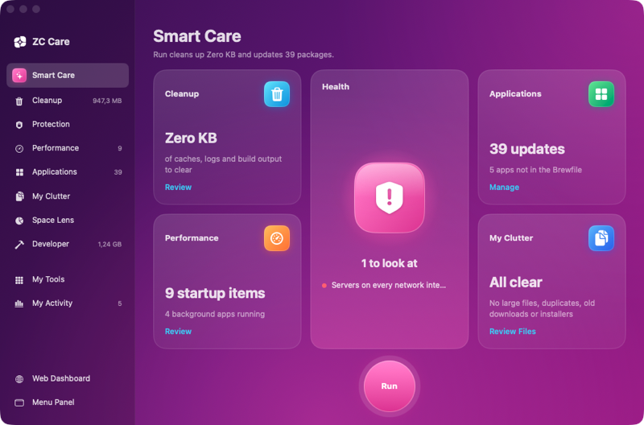
</p>

<p align="center">
  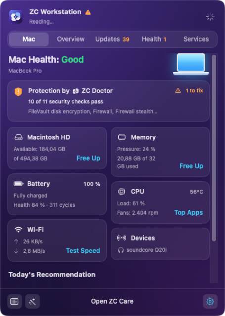
  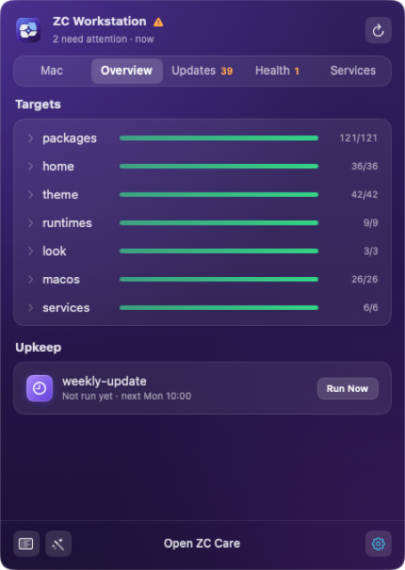
  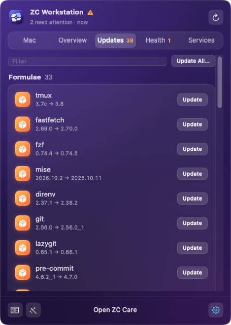
</p>

## Install

ZCBar needs macOS 14 or later, Xcode or the Swift toolchain, and the
`zc-workstation` CLI. From the repository root:

```console
$ make app-install
installed ~/Applications/ZCBar.app; open it once, then tick Open at login
```

This builds `bin/ZCBar.app`, signs it ad hoc and copies it to
`~/Applications`. ZCBar has no Dock icon; look for the mark in the menu bar.

A Finder-opened app gets no shell environment. ZCBar therefore:

- reads `PATH` from your login shell
- looks for `zc-workstation` on that `PATH`, then in `~/.local/bin` and
  `/opt/homebrew/bin`

If `ZC_WORKSTATION_CONFIG` is set, `make app-install` passes it to the app
once. Use *Choose Config…* in the panel to change it later.

## How it works

ZCBar does not reimplement zc-workstation. It runs the CLI and reads its
`-json` output. ZC Care is the one part that works on files itself:

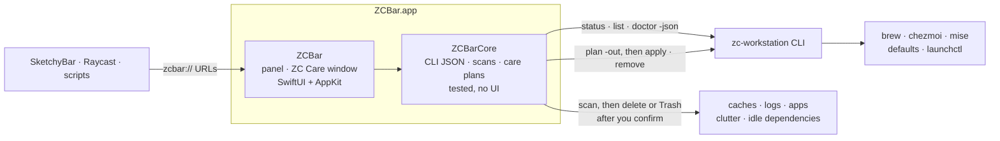

| ZCBar shows | From |
|---|---|
| What each target has and misses | `zc-workstation status -json` |
| Outdated and undeclared items | `zc-workstation list -json` |
| Health findings | `zc-workstation doctor -json` |
| *Apply*, *Update* | `plan -out` (with `-upgrade` and `-only` for updates), then `apply` of that saved plan |
| *Uninstall* | `zc-workstation remove` |

Every change that touches the workstation goes through the CLI. The CLI's
checks therefore hold here too: plan before apply, verify after, and no
uninstall without a yes.

ZC Care's cleaning works on files directly. Each module scans first and
shows what it found. Nothing is removed until you press its button and
confirm:

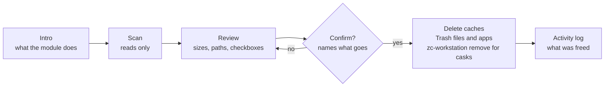

## The panel

Click the mark, or press ⌃⌥Z, to open the panel.

| Tab | Shows |
|---|---|
| Mac | Disk, memory, CPU, battery, network and sensors, the largest junk folders, and advice. |
| Overview | Each target with what is in place and missing, and *Apply* per target. |
| Updates | Outdated packages and runtimes, with *Update* per item and *Update All…*. |
| Health | `doctor` findings, with *Fix*, *Copy Fix* and *Ignore*. |
| Services | Homebrew services and launchd agents, with *Start*, *Run Now* and logs. |

The panel's settings turn on:

- notifications
- the ⌃⌥Z hotkey
- the weekly Smart Care scan
- opening at login

Each tile on the Mac tab opens a detail. *Free Up* on Disk lists the
folders it can clear, with their sizes. *Top Apps* on CPU lists what is
busy. The bottom bar opens ZC Care and the settings.

If [SketchyBar](https://github.com/FelixKratz/SketchyBar) is installed,
ZCBar sends it the count of open items for its `zcbar` item.

## ZC Care

| Module | Does |
|---|---|
| Smart Care | Scans everything at once: junk, clutter, updates, health. *Run* cleans up, then updates. |
| Cleanup | Clears caches, logs, build output, npx packages and Mail downloads. Clears AI clutter: Claude Code temp files and old versions, and the caches and logs of Claude, Cursor, ChatGPT, Windsurf, Codex, Gemini CLI and Chrome DevTools MCP. Empties the Trash. |
| Protection | Shows Gatekeeper's verdict per app, background apps and the privacy permissions apps hold. |
| Performance | Manages login items and runs maintenance: free RAM, flush DNS, thin Time Machine snapshots, reindex Spotlight, clean Homebrew, Docker and simulators. |
| Applications | Uninstalls an app with what it keeps in the Library. *Adopt* replaces a hand-installed app with its Homebrew cask. Finds leftovers of removed apps. |
| My Clutter | Finds large files, duplicates, old downloads and installers. |
| Space Lens | Maps what fills your home folder. |
| Developer | Finds `node_modules` and virtualenvs of projects untouched for 90 days, and local models from Ollama, LM Studio and Hugging Face. |
| My Tools | Lists every tool as a searchable card, including *Screen Cleaning Mode*. |
| My Activity | Shows Mac health, disk use, what ZC Care freed by kind, recommendations and recent runs. |

<p align="center">
  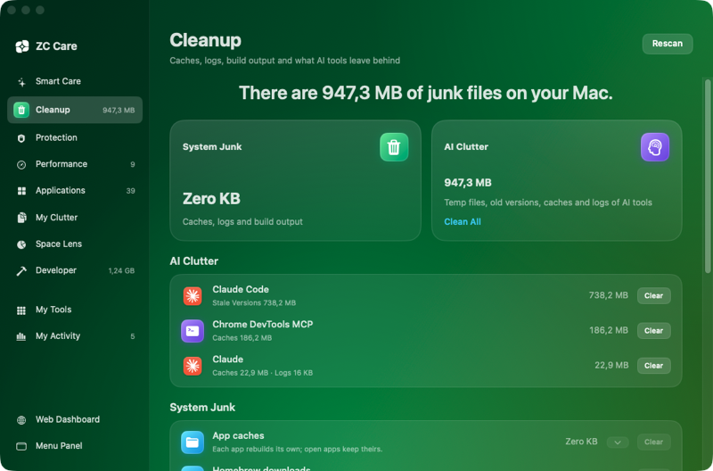
  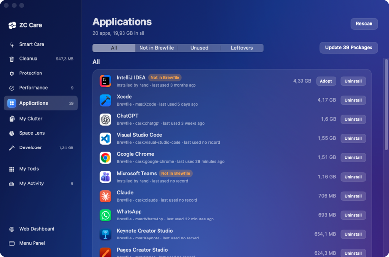
</p>
<p align="center">
  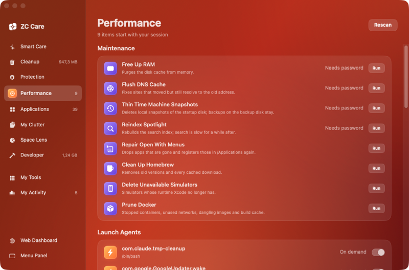
  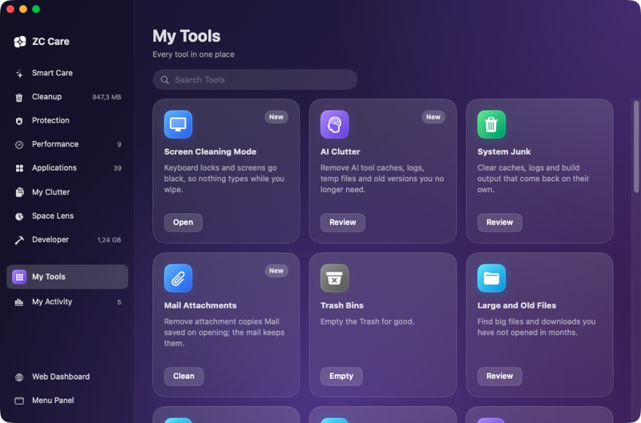
</p>

Each module opens on an intro that says what it does, before anything is
scanned:

<p align="center">
  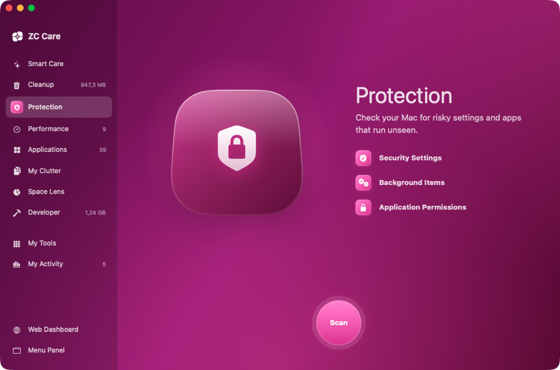
</p>

### Where things go

- **Deleted:** junk, caches and AI clutter. Each tool makes them again.
- **Moved to the Trash:** files, apps, leftovers, dependencies and models.
  You can put them back.
- **Uninstalled through `zc-workstation remove`:** Homebrew apps, so they
  also leave the Brewfile.
- **Admin tasks** ask for your password in a macOS dialog.

### What it never touches

- AI chats, settings and sessions: `~/.claude/projects`, `~/.codex/sessions`.
- The Claude Code version that `~/.local/bin/claude` runs.
- A Claude Code temp folder used in the last day.
- Caches of apps that are open.

ZC Care keeps its last scan in `~/Library/Caches/dev.zoolcoder.zcbar` and its
activity log in `~/Library/Application Support/dev.zoolcoder.zcbar`. Both are
outside what Cleanup clears.

### Permissions

- **Full Disk Access** lets Protection read privacy permissions. An ad hoc
  signed build is a new app to macOS, so each rebuild asks again.
- **Finder automation** lets Cleanup empty the Trash. It asks once.

## URLs

ZCBar registers the `zcbar://` scheme, so scripts, SketchyBar and Raycast
can open it:

| URL | Opens |
|---|---|
| `zcbar://panel` | Toggles the panel. |
| `zcbar://panel/updates` | A panel tab. |
| `zcbar://panel/overview/home` | A target in the Overview tab. |
| `zcbar://panel/mac/disk` | A tile in the Mac tab. |
| `zcbar://care` | The ZC Care window. |
| `zcbar://care/cleanup` | A module, matched by the start of its name. |

```console
$ open zcbar://care/developer
```

## Layout

```text
Package.swift        SwiftPM: ZCBarCore, ZCBar, ZCBarCoreTests
Sources/ZCBarCore/   the logic, no UI: CLI JSON, discovery, scans, care plans, activity log
Sources/ZCBar/       the SwiftUI and AppKit app: panel, Care window, hotkey, notifications
Tests/ZCBarCoreTests/ tests for ZCBarCore
Resources/           AppIcon.icns and MenuBarMark.pdf
screenshots/         the images in this README
icon/                mark.svg and make-icon.swift, which draws the icons
package.sh           builds the release binary and wraps it in an ad hoc signed .app
```

## Develop

From the repository root:

```console
$ make app-test      # swift test: the ZCBarCore tests
$ make app           # bin/ZCBar.app
$ make app-install   # copy it to ~/Applications
$ make app-icon      # redraw the icons from icon/mark.svg
```

Put logic in `ZCBarCore`; it is what the tests cover. Keep `ZCBar` to views
and AppKit glue.

A change that deletes or trashes files must:

- ask first, naming what it removes
- come with a test proving it leaves alone what it must keep

`zcbar://` URLs open the installed app, so test them after
`make app-install`. CI builds and tests the app on a macOS runner.

More is in the manual's
[Menu bar app and ZC Care](https://zoolcoder.github.io/zc-workstation/zc-workstation/app.html)
page.
